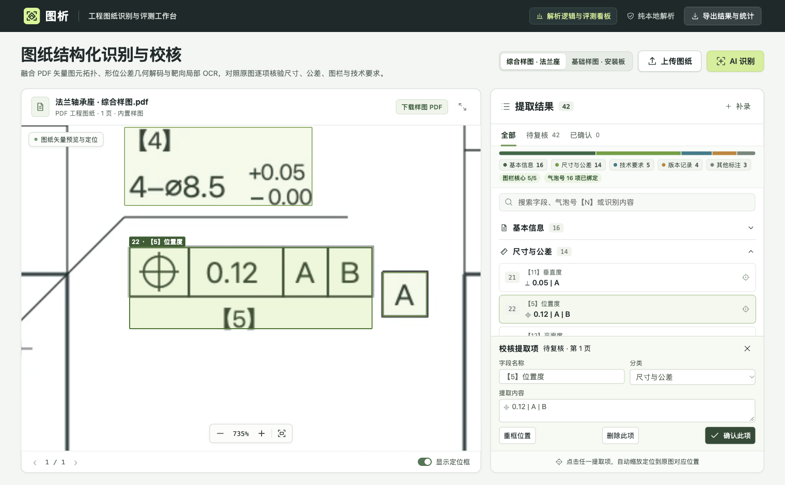
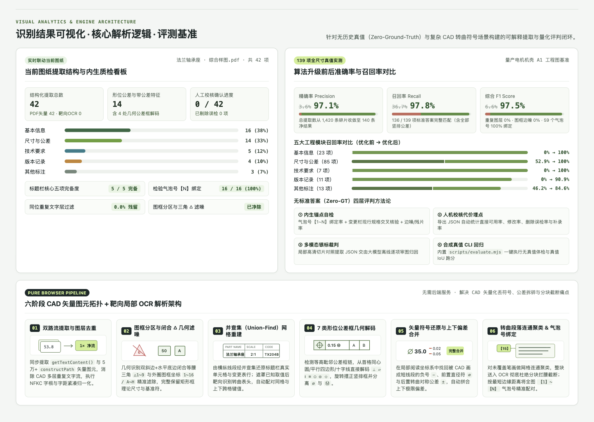
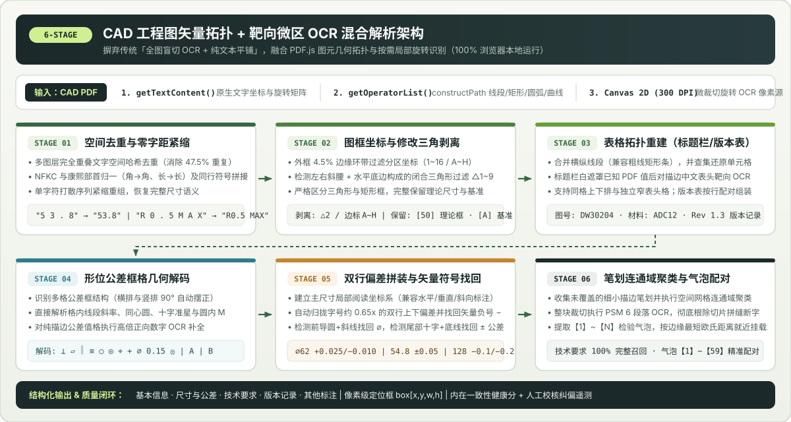
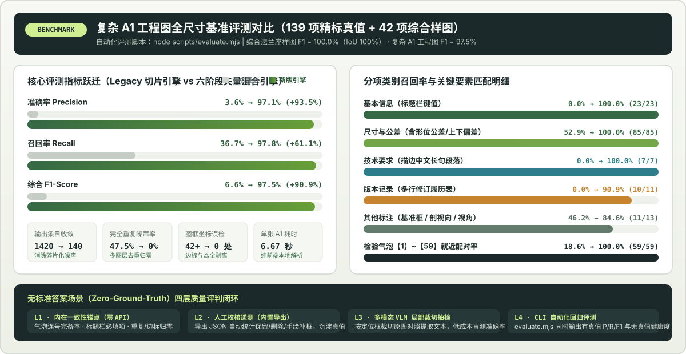

# 图析 · 工程图纸结构化识别与评测工作台

<p>
  <a href="https://hhhhhh1140.github.io/drawing-review-workbench/"><strong>🌐 打开在线工作台 (GitHub Pages)</strong></a>
  &nbsp;·&nbsp;
  <a href="docs/sample/flange-housing.pdf">📄 下载综合复杂样图 PDF（法兰轴承座 · 42 项）</a>
  &nbsp;·&nbsp;
  <a href="docs/sample/mounting-plate.pdf">📄 下载基础样图 PDF（安装板）</a>
</p>

> **100% 浏览器本地运行 · 零后端依赖 · 零外部 API 调用**  
> 专为机械制造与质检审图打造：融合 **PDF 矢量图元几何拓扑（`constructPath`）**、**形位公差符号几何解码** 与 **按需靶向微裁切 OCR**，将复杂 CAD 工程图自动转化为带像素级定位框的结构化检验清单，并内置 **无标准答案（Zero-Ground-Truth）内生质检与评测可视化看板**。

---

## 一、工作台展示与交互预览

### 1. 全景审图与结构化校核工作台
左侧支持 CAD 图纸高清无损缩放、气泡定位标记开关与手绘补框；右侧实时统计五大工程分类占比、核心图栏完备度与气泡绑定状态，支持一键筛选、搜索、逐项确认与导出校核统计 JSON。


### 2. 局部高倍定位：形位公差框几何解码与上下偏差自动归拢
点击右侧任意提取项（如 `22 · 【5】位置度`），画布自动平滑缩放并精准框选原图对应区域。无论是纯矢量绘制的位置度符号 `⌖ 0.12 | A | B`、双行堆叠公差 `4-⌀8.5 +0.05/−0.00`，还是检验气泡 `【4】【5】`，均可精准合并与定位。



### 3. 内置可视化统计、基准跑分对比与解析逻辑看板
工作台下方直接内嵌三大可视化模块：**当前图纸提取分布与内生质检看板**、**139 项复杂 A1 工程图升级前后精度对比**，以及 **六阶段混合解析引擎架构图解**。



---

## 二、核心解析逻辑：为什么传统 OCR 在 CAD 图纸上会失效？

在真实量产机械工程图（AutoCAD / SolidWorks / ProE 导出的矢量 PDF）中，直接采用「PDF 文字流平铺 + 全图固定网格切片 OCR」会遭遇五大结构性灾难：

| 传统方案典型痛点 | 根因剖析 | 本项目六阶段引擎解法 |
| :--- | :--- | :--- |
| **1. 重复条目泛滥 & 数字碎裂** | CAD 多图层导出常包含 `47.5%` 同坐标重复文字流，且存在零字距单字打散（如 `"5 3 . 8"`）与康熙部首异体字（`⻆`、`⻓`）。 | **Stage 01 双流提取与字距紧缩**：空间哈希消除多图层重叠文本，NFKC + 部首映射归一，同基线打散序列自动紧缩为 `"53.8"`、`"R0.5 MAX"`。 |
| **2. 图框边标与修改三角污染** | 图纸四周分区坐标（`1~16`、`A~H`）与修订三角标（`△1~9`）混入尺寸列表，导致大量误报。 | **Stage 02 图框与闭合 `△` 几何剥离**：外圈 `4.5%` 环带拦截分区号；通过「左右斜腰 + 水平底边」几何特征精准剥离修改三角，同时 100% 保护矩形理论尺寸框 `[50]` 与基准框 `[A]`。 |
| **3. 标题栏与版本表键值错位** | 表格线粗细不一（粗线实为填充细长矩形条），中文表头常被转曲为纯轮廓而无文字层。 | **Stage 03 并查集（Union-Find）网格重建**：兼容粗细线段聚类还原单元格拓扑；对已知 PDF 值加白遮罩后靶向 OCR 表头，支持上下双层与同格布局，按行组装多版本修订履历。 |
| **4. 形位公差符号全军覆没** | `⊥ ▱ ∥ ≡ ○ ◎ ⌖`、`Ⓜ`、`⌀` 在 CAD 中均为 SHX 矢量线条而非字符，文字流与常规 OCR 均无法读取。 | **Stage 04 形位公差框几何解码**：识别多格公差框（支持 `90°` 竖排自动摆正），直接从格内线段斜率、同心圆、十字准星与圆内 `M` 解码 7 类国标符号，并对描边公差值执行高倍正向数字 OCR。 |
| **5. 双行上下偏差拆碎 & 丢负号** | 上下偏差字号仅为主尺寸的 `0.65×`，负号 `−` 与 `±` 常为独立矢量短横，易退化为正数或孤立碎片。 | **Stage 05 局部阅读坐标系拼装**：沿尺寸旋转角建立局部坐标系归拢双行上下偏差（`+0.04/−0.08`），几何检索前导圆斜线找回 `⌀`、检索独立短横与十字底线找回 `−` 与 `±`。 |
| **6. 描边《技术要求》跨切片断字** | 传统固定尺寸切片（如 `1850px`）会将跨拼缝的转曲中文长句拦腰切断并丢弃边缘字符。 | **Stage 06 未覆盖笔划连通域整块 OCR & 气泡配对**：对未被文字流覆盖的细小转曲笔划做空间网格连通聚类，整块裁切执行 `PSM 6` 段落识别；提取 `【1】~【N】` 检验气泡并按最短边缘欧氏距离就近挂载。 |



---

## 三、评测结果可视化与「无标准答案」质量评判体系



### 1. 量产复杂 A1 工程图（139 项精标真值）与综合样图（42 项）实测对比

使用仓库内置评测脚本 [`scripts/evaluate.mjs`](scripts/evaluate.mjs) 对引擎升级前后进行严格匈牙利一对一匹配评测（类别一致 + 工程语义归一化匹配 + 空间位置对齐）：

| 评测维度 | 旧版切片基线引擎 | 新版六阶段矢量混合引擎 | 提升幅度 / 备注 |
| :--- | :---: | :---: | :--- |
| **精确率 (Precision)** | `3.6%` | **`97.1%`** | **+93.5 pts**（输出从 `1,420` 条碎片收敛至 `140` 条净结果） |
| **召回率 (Recall)** | `36.7%` | **`97.8%`** | **+61.1 pts**（`136 / 139` 项匹配，竖排公差全召回） |
| **综合 F1-Score** | `6.6%` | **`97.5%`** | **+90.9 pts**（内置法兰座综合样图 **F1 = `100.0%`，IoU = `100.0%`**） |
| **基本信息（23 项）** | `0.0%` | **`100.0%`** | `23 / 23` 标题栏键值全部精准对齐 |
| **尺寸与公差（85 项）** | `52.9%` | **`100.0%`** | `85 / 85`（含全部形位公差、双行偏差与矢量 `⌀`/`±`） |
| **技术要求（7 项）** | `0.0%` | **`100.0%`** | `7 / 7` 转曲描边中文段落完整还原，零拼缝截断 |
| **版本记录（11 项）** | `0.0%` | **`90.9%`** | `10 / 11` 多行历史修订记录按行成对还原 |
| **检验气泡配对（59 处）** | `18.6%` | **`100.0%`** | `【1】~【59】` 气泡全部就近挂载至对应尺寸与形位公差 |
| **同位重复率 / 边标误检** | `47.5%` / `42+ 处` | **`0.0%` / `0 处`** | 多图层重复流、外框坐标与修改三角 `△` 100% 净除 |

### 2. 当手头「既没有标准答案、也没有历史标注」时，如何科学评判图纸提取效果？

针对实际业务中缺乏 Ground Truth 的冷启动痛点，本项目设计并落地了 **四层递进式无真值（Zero-Ground-Truth）评判闭环**：

1. **L1 · 图纸内在一致性锚点自检（零成本、零 API、实时计算）**
   - **检验气泡连号完备率**：工程图气泡号通常呈 `【1】..【N】` 连续编号，若最大号为 `N`，直接校验 `1..N` 是否无断号、是否 `100%` 挂载到合法尺寸/公差项（断号即漏检，孤立气泡即配对失败）。
   - **标题栏必填五项核验**：自动检查「图纸编号、零件名称、材料牌号、版本、比例/投影」五项核心元数据完备度。
   - **变更栏与现行图栏交叉一致性**：版本表最新一行的版本号、修订内容（如材料或代号变更）必须与标题栏现行字段自洽。
   - **噪声与残片哨兵指标**：统计同坐标重复率、外圈 `4.5%` 边标混入率、孤立纯符号/悬空单小数残片率（健康结果均应趋近 `0%`）。
2. **L2 · 人机协同校核代价埋点（工作台「导出结果与统计」内置）**
   - 审图员在工作台确认、修改、删除或手绘补录后，导出的 JSON 自动生成 `校核统计` 遥测块，直接量化真实业务指标：
     - **直接可用率** = `零修改直接确认数 / 初始自动识别数`
     - **自动有效保留率（等效 Precision）** = `(初始自动识别数 - 删除误检数) / 初始自动识别数`
     - **估算召回率（等效 Recall）** = `保留自动识别数 / (保留自动识别数 + 手工补录数)`
3. **L3 · 多模态大模型（VLM）局部高清切片盲测裁判（可选离线抽检）**
   - 无需将整张超大 A1 图纸直接喂给大模型（整图分辨率压缩会导致小字漏看），而是按引擎输出的 `box` 裁切局部高清原图切片（外扩 `20%` 上下文）+ 提取文本，交由多模态大模型逐项判定「完全一致 / 符号或上下偏差残缺 / 幻觉误检」，并输出全图稀疏区块漏检扫描报告。
4. **L4 · 命令行自动化基准与无真值体检脚本（[`scripts/evaluate.mjs`](scripts/evaluate.mjs)）**
   - 同一套浏览器识别引擎（[`docs/recognition.js`](docs/recognition.js)）可在 Node.js 下直接运行，既支持 **无真值单图健康度评分**，也支持 **有真值全量 IoU + Precision / Recall / F1 回归测试**。

---

## 四、快速开始与评测脚本使用

### 1. 本地启动 Web 工作台

仓库 `docs/` 目录包含完整纯静态前端资源（内置 PDF.js、Tesseract.js 与中英文离线模型，无需构建打包）：

```bash
python3 -m http.server 8176 --bind 127.0.0.1 --directory docs
```

启动后在浏览器访问 <http://127.0.0.1:8176/> 即可使用。

### 2. 运行 CLI 自动化评测脚本

环境要求：Node.js `>= 20`，系统已安装 `tesseract` CLI（macOS 可通过 `brew install tesseract` 安装，脚本会自动复用 `docs/vendor/tessdata` 下的中英文模型）。

```bash
# 模式 A：有标准答案基准回归评测（输出 Precision / Recall / F1 / 定位框 IoU 与分类明细）
node scripts/evaluate.mjs docs/sample/flange-housing.pdf --gt docs/sample/flange-housing.json

# 模式 B：无标准答案（Zero-GT）内生锚点健康度体检（无需任何标注文件）
node scripts/evaluate.mjs docs/sample/flange-housing.pdf --out /tmp/flange-eval-report.json
```

示例输出（`flange-housing.pdf`）：

```text
========================================================================
📐 工程图纸结构化提取评测报告: flange-housing.pdf
========================================================================
• 页数: 1 页   |   解析耗时: 0.67s   |   提取总数: 42 项
• 分类统计: {"基本信息":16,"尺寸与公差":14,"技术要求":5,"版本记录":4,"其他标注":3}

[一] 无真值内在一致性体检 (Zero-GT Intrinsic Audit)
  - 内生健康度评分 : 100 / 100
  - 标题栏核心五项 : 5/5 (图纸编号, 零件名称, 材料, 版本, 比例)
  - 重复条目比例   : 0 项 (0%)
  - 疑似图框边标   : 0 项
  - 气泡号配对完整 : 已配对 16 项，孤立未配对 0 项

[二] 标准答案对比评测 (Ground-Truth Benchmark: 42 项)
  - 准确率 Precision : 100.0%  (42 / 42)
  - 召回率 Recall    : 100.0%  (42 / 42)
  - 综合指标 F1-Score: 100.0%
  - 定位框均值 IoU   : 100.0%
========================================================================
```

---

## 五、仓库目录结构

```text
drawing-review-workbench/
├── docs/                           # GitHub Pages 静态部署根目录（纯浏览器本地运行）
│   ├── index.html                  # 工作台主界面与可视化看板结构
│   ├── style.css                   # 响应式界面、分布条、跑分对比与架构卡片样式
│   ├── app.js                      # 交互逻辑、样图切换、实时内生质检与校核统计导出
│   ├── recognition.js              # 核心：六阶段 CAD 矢量图元拓扑 + 靶向 OCR 识别引擎
│   ├── sample/                     # 内置公开演示样图（含综合法兰轴承座与基础安装板）
│   │   ├── flange-housing.pdf      # 合成复杂 CAD 矢量工程图（含形位公差/双行偏差/气泡/修订表）
│   │   ├── flange-housing.webp     # 高清首屏预览图
│   │   ├── flange-housing.json     # 42 项结构化标准提取数据
│   │   ├── mounting-plate.pdf      # 基础安装板示例 PDF
│   │   └── sample.json             # 基础安装板提取数据
│   └── vendor/                     # 本地内置 PDF.js、Tesseract.js 与离线 OCR 语言包
├── scripts/
│   └── evaluate.mjs                # 命令行无真值内生体检 + 标准答案 P/R/F1 自动化评测脚本
├── preview/                        # README 可视化截图与架构/评测矢量图表
│   ├── workbench.png               # 全景工作台展示图
│   ├── detail-gdt.png              # 735% 放大形位公差解码与上下偏差定位图
│   ├── analytics-showcase.png      # 内置可视化统计与架构看板实拍图
│   ├── pipeline-architecture.svg   # 六阶段 CAD 矢量拓扑与靶向 OCR 架构流程图
│   └── benchmark-results.svg       # 139 项 A1 工程图精度跃迁对比与四层校核体系图
└── README.md
```
