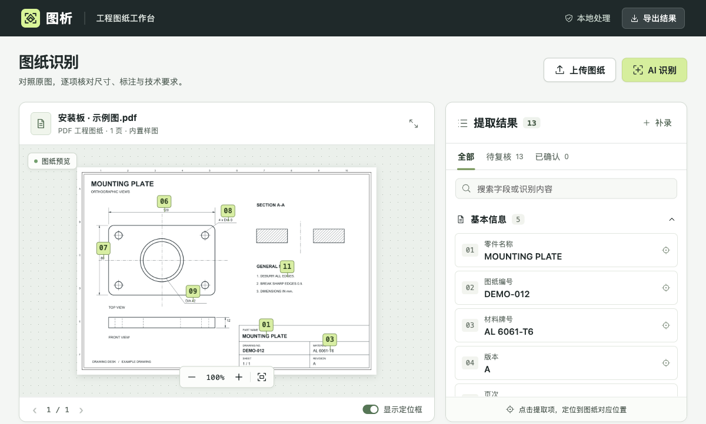

# 图析 · 工程图纸识别工作台

[打开在线工作台](https://hhhhhh1140.github.io/drawing-review-workbench/) · [下载安装板示例 PDF](docs/sample/mounting-plate.pdf)



上传 PDF 或图片后，点击 **AI 识别**。右侧显示提取结果，点击结果可放大并定位到左侧原图。支持修改字段和内容、重新框选、补录、逐项确认，以及导出带页码和位置的 JSON。

- 支持多页 PDF，以及 PNG、JPG、WebP 和 BMP 图片。
- 使用 PDF 文字层和中英文 OCR 提取文字与位置。密集标注、工程符号和公差仍需人工核对。
- 图纸读取、识别和校核均在浏览器内执行。校核记录保存在当前浏览器，使用「导出结果」可另存一份。
- 首页内置安装板演示，可直接体验点选定位和编辑。

## 本地运行

在仓库根目录执行以下命令，然后访问 <http://127.0.0.1:8176/>。

```sh
python3 -m http.server 8176 --bind 127.0.0.1 --directory docs
```

`docs/` 包含完整的静态应用及本地运行所需资源。浏览器端的第三方组件包括 PDF.js、Tesseract.js 与 Tesseract OCR 模型。组件许可文本随资源保存在 `docs/vendor/`。
